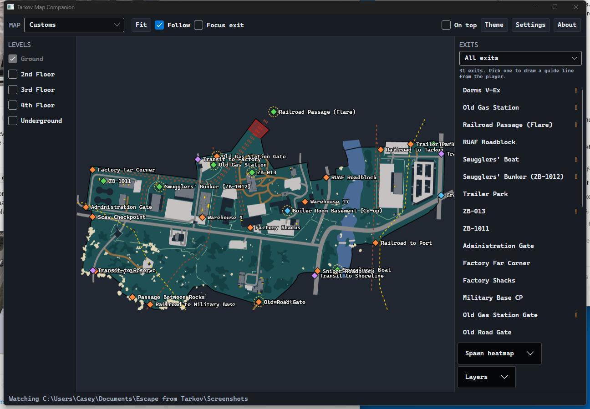

简体中文 · [English → README.md](README.md)

# Tarkov Map Companion

《逃离塔科夫》的第二屏地图：你现在在哪、面朝哪个方向、怎么走到选定的撤离点。

原理是盯着截图文件夹。塔科夫把坐标和镜头朝向写进每张截图的*文件名*里，所以你按一次截图键，地图就更新一次。



## 关于本分支

本分支是 [`Battleroid/tarkov-map-companion`](https://github.com/Battleroid/tarkov-map-companion) 的自我改进版。原作者 Battleroid 的项目采用 MIT 协议，本分支的一切都建立在它之上。

下面的内容沿用原 README 的结构和文字，只在本分支确实不同的地方做了补充和修正。想了解本分支没有动过的功能，请看原仓库。

本分支新增和改动的部分：

- **全面中文化。** 所有控件、面板、偏好设置、楼层名、图层标签和撤离条件都已翻译，并在**设置**里提供语言切换。全新安装默认中文；已有的 `settings.json` 会保留它原本记下的语言。
- **修正内置的撤离点数据。** 内置的 tarkov.dev 数据带着三处缺陷，构建列表时会做归一化，撤离点列表因此能正常阅读。见[数据来源](#数据来源)。
- **局域网同步（WebSync）。** 开启后，程序会把自己这张地图的只读镜像通过你的局域网提供给平板或手机，附带二维码，每个请求都要带令牌。详见下文**在平板上，通过局域网**。
- **设置窗口改成分类栏。** 原来十三个堆在一起的区块收成六个页面，外加一个专门的**局域网同步**页；对话框不再是一条长滚动条，而是一排分类。

本分支有两处已知缺口，都是有意留下并写进 `docs/` 的：撤离面板的 OCR 仍然只认英文撤离点名称，所以在中文游戏客户端上**识别撤离点**不会生效；WebSync 的浏览器页面只有简体中文，跟桌面端设成什么语言无关。见*功能*一节末尾的**已知问题**。

## 这不是作弊

程序从不读取游戏内存、不挂钩进程、不注入任何东西、不改动游戏文件，也不和游戏做任何形式的通信。它知道的一切都来自游戏自己写到你硬盘上的文件，而且只读不写：

- 截图的**文件名**，用来确定你的位置和朝向；
- 可选的**截图内容**，用来读你屏幕上已经打开的撤离点列表；
- 可选的**游戏日志**，游戏运行时自己写的，用来判断它正在加载哪张地图。

你自己没截下来的画面它看不到，其他玩家的位置它也看不到。

日志是这三样里最新的一个，也是唯一不是你按某个键才产生的，所以默认关闭，在设置里有独立的开关。它用到的内容很窄：游戏写下"即将加载某张地图"的那一行，和你获得操作权的那一行。那是塔科夫安装目录里的一个纯文本文件，记事本就能打开，里面没有关于任何人位置的信息，也不会有任何东西被写回去。

**局域网同步**是这里唯一会开网络端口的功能，所以有必要说清楚：它默认关闭，只监听你的局域网，上面每条路由要么读取桌面窗口已经在显示的内容的副本，要么把这份副本再发一遍。它没有任何写入路径——浏览器动不了你的标记、删不掉备注、改不了设置——而且除了页面本身，每个请求都必须带上自动生成的令牌。

## 安装

从 [Releases](https://github.com/BlueMess/tarkov-map-companion-self-improv/releases) 下载最新的 **`TarkovMapCompanion-vX.Y.Z-win-x64.exe`**，直接运行。

不需要安装任何东西。.NET 已经打包在程序里，地图和撤离点数据也都内置了，断网也能用。

> 可执行文件比原版大——大约 62 MB，原版约 30 MB——因为局域网同步把 ASP.NET Core 共享框架一起带进来了。

> Windows SmartScreen 第一次会警告这是未签名的可执行文件，选**更多信息**，再选**仍要运行**。每个版本都由 GitHub Actions 按仓库里的标签构建，想确认二进制文件的来历，可以去看构建日志。

## 功能

**位置和朝向。** 局内截一张图，标记就动一下。身后留下一条轨迹，显示你这一局走过哪里；状态栏显示坐标、朝向、局内时钟，以及这局已经打了多久。

**轨迹按局分开。** 塔科夫的局内时钟按真实时间的 7 倍走，所以只要比较两个时钟是否同步，就分得清哪几张截图属于同一局。昨天的路线不会被接到今天的路线上，超过当地图单局时长的部分也不会再画。

**界面语言。** 英文或简体中文，在**设置**里选，重启后生效。全新安装默认简体中文；已有的 `settings.json` 保留它原本记下的语言。每个控件、面板和偏好项都已翻译，共 529 条字符串，两个文件的键完全一致；楼层名、图层标签、阵营标签以及撤离条件本身也都翻译了。

专有名词保持拉丁字母：PMC、Scav、AI、Boss 名、商人名、Kappa、`ZB-####` 撤离点代码——游戏里就是这么显示的。撤离点代码尤其如此，即使中文数据里给了翻译也一样，`ZB-1011` 就显示为 `ZB-1011`，而不是某个翻译过来的地名。每条撤离条件按当前语言单独成行显示，不会出现中文压在英文底下这种情况。

语言唯一够不着的，是撤离面板的 OCR，它仍然拿英文撤离点名称做匹配，见下文**已知问题**。

**撤离点和它的条件。** 每个撤离点都画在图上，按阵营着色。有条件的撤离点在地图上带一圈光环，在列表里带标记，选中之后会告诉你它需要什么：

- 峭壁斜坡 — *Red Rebel 冰镐 · 伞绳 · 未装备防弹衣*
- 下水道检修孔 — *未装备背包*
- 宿舍载具撤离点 — *每位玩家 5000 卢布 · 最多 4 人*
- 走私者的船 — *写有代码词 Voron 的纸条*

**只留下你真有的撤离点。** 塔科夫每局给你的撤离点都不一样，取决于你出生在哪——海关有 27 个，某一局可能只给你 4 个。在撤离点面板里勾上**识别撤离点**，在游戏里调出撤离列表（默认双击 <kbd>O</kbd>），截一张图：程序会从画面里读出这份列表，把游戏这局没给你的撤离点变暗。

撤离点只变暗，不会消失，也照样能点。列表来自文字识别，读错一次的代价应该是一个变暗的标记，而不是一个找不到的标记。读到了但定位不了的，会在面板里点名说出来，不会悄悄丢掉。识别结果在一局之内不断累积，所以哪怕截图时面板才刚打开一半，也只会往已有结果上加东西；等这一局结束或你换地图，整批结果全部作废。它用的是 Windows 自带的 OCR 引擎，不增加下载体积，每张截图大约 25 毫秒。

在 1024x768 到 5120x1440 之间、4:3 / 5:4 / 16:9 / 21:9 / 32:9 各种比例下，PMC 和 Scav 两种列表都验证过。分辨率低的画面会先放大再识别，因为低于大约 900 行时，面板上的字小到整行会直接看不见，而不是看错。哪次识别出了问题，`--read-exits` 会把每一步都打印出来。

**引导线和聚焦模式。** 选一个撤离点，就会画一条实线连过去，线上标着距离和你要转的角度（`348 m, 18° right`）。线的颜色你自己定，再点一次同一个撤离点就放开。打开**聚焦撤离点**，视图会把你和撤离点一起框住，随着你靠近越收越紧，屏幕上只剩真正要紧的东西；关掉之后，之前的视图原样回来。

选中撤离点会列出它的条件。当合作撤离点下面四行条件把别的东西挤出屏幕时，**隐藏条件**可以把它收起来。列表里的警告标记和地图上的光环始终保留：收起杂乱，不该顺带把"这个撤离点有条件"这件事也藏掉。

**路线标记。** 按**标记路线**，然后按你想去的顺序点地图——任务目标、值得绕路的藏身处、你丢东西的那个位置。每次点击留下一个带编号的图钉；再按一次**标记路线**，或按 <kbd>Esc</kbd>，结束。箭头沿着路线朝下一个图钉推进，不用看数字也能判断路线往哪边绕。引导线会按顺序跟着路线走，走完才重新指回你选的撤离点，所以撤离点可以全程保持选中而不挡路；同样的道理，聚焦模式框的是下一个标记，而不是撤离点。

走进某个图钉 50 米以内，它就退休了，这个半径可以在**设置**里调。默认情况下它会先显示为"已到达"一张截图，下一张就消失：这一次确认才是重点，图钉凭空消失会让你分不清自己到底是走够了，还是放错了地方。另一个选项则是一进半径就立刻移除。**清除标记**会丢掉整条路线，把引导线还给撤离点。

**平滑镜头。** 打开**跟随玩家**，视图会平滑地滑到你的新位置，而不是直接跳过去。跳一下就丢掉了方位感——每截一张图你都得重新在地图上找自己——而能跟上的移动不会这样。聚焦模式重新取景时也一样。但你自己的平移和缩放永远不会被接管，它们始终跟着指针走。开关在**设置**里。

平移和缩放**不会**把跟随关掉。两次截图之间你正在看地图某个角落，正是你预期会被拉回中央的时候，以前程序却会悄悄自我解除。现在只有按钮能关它，而且开启时按钮会亮起来，被重新居中不会再让人措手不及。

**按距离排序。** 撤离点列表按你最后已知位置的距离重排；无论开不开，每个撤离点都显示自己的距离。撤离点标签页显示全部，因为哪个阵营能用哪个撤离点本来就写在各自那一行上，一份和地图对不上的列表比一份更长的列表更糟。如果只玩一个阵营，**设置**里仍有阵营筛选。

**名字互相让位。** 撤离点、任务、备注和队友的标签由同一轮排版统一安排，这一轮知道所有标签的存在，所以每个名字都会落在还没被别的名字占住的位置上。先来先得：哪个图层先提出请求，就保留它想要的位置；其余的向上、向下或挪到标记的另一侧，凡是挪得远到可能认错的，都会拉一根细线指回它标注的东西。地图美术里烤死的标签动不了，那些位置仍然可能被压住。

**出生热力图。** PMC、Scav、AI PMC 和 Boss 的可能出生点。半径按游戏内米数设定，所以缩放改变的是你看到多少，而不是数据本身；每个色带都相对自己的峰值缩放，稀疏的那一组放在密集的那一组旁边也还看得见。

**其他图层。** 战利品容器、危险区域、上锁的门、开关、固定机枪、BTR 停靠点、Boss 区域和转移点，每一项都能单独开关。图层和热力图放在浮在地图左下角的**图层**面板里，和**楼层**在一起——画在地图上的是地图本身的属性，开关就该在那儿。

**截图清理。** 可选，**默认关闭**。打开后可以只保留最新的 N 张截图，或者每读完一张就删掉。删除的文件进回收站，绝不会删到监视文件夹外面，也绝不会碰任何不符合塔科夫截图命名规则的文件。

**13 张地图全部支持。** 海关、工厂、中心区、破冰船、立交桥、实验室、迷宫、灯塔、储备站、海岸线、塔科夫街区、码头、森林。

**楼层切换，包括地面层。** 地图美术把楼层当成不透明几何体叠在一起，所以地下楼层会被地面层挡住。关掉**地面层**才能露出来，工厂的隧道是最明显的一例。**楼层**控件浮在地图左上角，平时收起，需要时再展开：多数地图根本没有楼层可切，为两个复选框占掉半块窗口不值当。

**地图识别。** 从下拉菜单里选地图；也可以让程序在一个"当前地图不可能包含"的位置出现时，把正确的地图推荐给你。它只推荐不自动切换，因为好几张地图在世界坐标上是重叠的，局中自动切错比不给建议更糟。当然，你也可以在**设置**里让它自动切。

**设置分为六个分类。** **常规**（外观、语言、置顶、地图数据）、**截图与日志**、**地图显示**（视图、标记、撤离点、小地图）、**任务**、**联机**、**局域网同步**。本分支把原来十三个区块堆成的一条长滚动条，换成了分类栏加分类页，局域网同步的开关也因此有了落脚点。改动即时生效，没有确定也没有取消；所有内容仍然可以直接在 `settings.json` 里手改。

**它已经知道你接了哪些任务。** 打开游戏日志后，程序会读塔科夫写下的商人消息并跟着走：接了任务就打勾，交了任务就取消。任务 id 就在通知里，所以这是精确的，不是猜的。在开发机上，它第一次运行就从一周的日志里还原出了 73 个进行中的任务。

它只知道日志里还留着的东西，所以早于最早那份日志接下的任务会显示成没接过。手动打勾照样有效，也不会因为日志没说什么就被撤销。推算出来的结果会缓存，所以清空日志文件夹只会丢掉历史，不会把一切丢掉。

**从游戏同步**会丢掉手动挑的列表，改成严格跟随日志里记录为已接取的任务。跟着事件走没法修好一个已经跑偏的列表——你关掉程序期间交掉的任务不会产生任何事件来取消勾选——所以它就是那个"按游戏知道的状态重新开始"的按钮。**此处生效**把列表筛成游戏记录为已接取、并且在你当前这张地图上有目标的任务，这才是你在局里真正会问的问题。

**把任务读清楚。** 点任务名，左侧打开一个面板：目标以你真读得清的字号列出，一条一块，每块都说明它是否在你眼前这张地图上，并各自带一个**路线**按钮。前置任务列出来，已完成的打勾；钥匙按它们能打开哪张地图分组，这张地图用的排在最前；每个目标都写出它要的物品——带图片，而且包括原文一带而过的替代品，因为"获取物品：Rye croutons"同样接受 Emelya rye croutons。面板可以缩放，也可以关掉。

**做完一个划一个。** 面板里每个目标都有自己的复选框，勾上的在那儿被划掉，它的标记也会整个从地图上撤下来，于是画出来的就是还没做完的部分。这是全程序唯一一处用隐藏而不是变暗的地方：别处的含糊是因为程序在猜，而一个勾是你自己声明的进度。塔科夫写的任何日志都不会告诉你一个任务做到哪一步了——通知日志会记录任务状态变化，但从不记录任务内部的条件——所以这只是写给自己的备注，并且就以备注的形式保存。**清除勾选**用于在新赛季重置某个任务。

**出门要带的东西。** 任务列表上方，任务标签页会汇总你勾选的所有任务在你当前这张地图上需要什么：钥匙，以及必须随身带着、而不是在柜台交出去的物品，各自标出数量。物品跨任务累加，因为埋一个就消耗一个；钥匙不累加，因为用一把钥匙不会用掉它。埋一个 MS2000 需要把标记器带在身上；上交五把 MP-133 不等于要背五把霰弹枪进海关，这份清单分得清。

**不用手输的等级。** 塔科夫没把你的等级写进任何日志——翻过十九个日志文件夹，没有经验值，没有升级行，组队通知里虽然带等级，但那是除你之外每个人的。一个要求 42 级的任务不可能在 41 级时接下，所以能确定的只有一个下限：日志里见过你接下的那些任务中，最高的等级要求，就是你至少已经到的等级。**根据日志**会把这个值写进去，而且只会上调——估算本来就慢于事实，把你手输的数值往下拉会藏起你其实接得了的任务。在开发机上，它从一周的日志里读出 52。

**任务追踪。** **任务**标签页列出全部 510 个任务，按商人分组，带搜索框和三个筛选：*在这张地图上*、*不高于我的等级*、*Kappa*。勾上一个，它的目标就画到地图上：区域按真实轮廓画，而不是一个点，于是"到访"目标读起来是*站进这个房间*，不是*在这附近某处*。任务物品可能在好几个地方刷新的，每一处都画成空心圆环而不是确凿的标记——你不该从四个可能的点位旁边走过去。

只有勾上的任务才画，这是设计而不是省事：光 Lighthouse 一张图就有 169 个有坐标的目标。要手动勾选，是因为你接了哪些任务记在 BSG 服务器上的个人资料里，而程序读的是文件，不是账号。

在某个任务上按**路线**，或者点它地图上的某个标记，它的目标就变成带编号的路线标记，也就顺带继承了到达判定、引导线，以及用你的颜色分享给小队。没有坐标的目标仍然会列在阅读面板里，因为"上交 5 把 MP-133"即使不在地图上，也值得放在地图旁边读一遍。

**在地图上写字。** 按**添加备注**，点一个位置，输入。标签保存在磁盘上，并且留在你写字的那张地图上，于是小队真正在用的叫法——*Big Red*、*狙击手小屋*、*标记钥匙刷新的位置*——就落到了地图上，而不是留在每个人脑子里。点自己写的标签可以改名，也可以从**备注**标签页删掉。

**导入**是往你的文件里合并，而不是替换掉它，所以有人给塔科夫街区每栋楼都标好了名字，可以把文件直接给你，而不用牺牲你自己那份。它能读程序自己的导出格式，也能读纯 `map,x,z,text` 列表——几百个楼名的现实来源是一张表格，不是手写的 JSON。

**把我的备注分享给小队**默认关闭，而且只发你自己的。队友的备注以他们的颜色显示，永远不会写进你的文件，会话结束就消失：一套标签是几周慢慢攒出来的东西，不是接下来十分钟的计划；人家刚加入就把你的标签推到他们三个人地图上这种事，不打招呼就做不合适。

**还没截一张图，地图就已经对。** 在设置里勾上**读取游戏日志以判断正在加载哪张地图**，程序就会跟着塔科夫运行时写的日志走。游戏在你拿到操作权前二十秒到两分钟之间就会写出它要加载哪张地图，所以出生瞬间第二块屏幕已经是对的那张，换图也不再需要等你截一张图、并且正好站在只有一张地图能解释的位置上。

它还知道一局什么时候开始，这比用时钟推算干净得多：你一拿到操作权，上一局的轨迹立刻就没了，而不是再等一两张截图。回到主菜单时什么都不清，因为打完之后回头看看刚才打成什么样，正是人们用这张地图做的唯一一件事。

默认关闭，取消勾选后它立刻停止读那个文件。安装目录是从游戏记在它自己 Unity 日志里的路径查出来的，装在第二块硬盘、注册表里什么都没有也能找到；找不到就自己填文件夹。`--find-logs` 会打印它试过的每个位置、解析器对最新一份日志的理解，以及这个版本不认识的任何地名——补丁之后地图不换图了，就把这个贴进 issue。

**小队位置。** **小队**面板浮在地图右上角，收起时是一个小药丸，按开才展开。按**创建**，程序给你一个像 `K7QM4-3FHB9-8TZR9-M4X7Q` 这样的代码。谁把它粘进**加入**，谁就出现在你的地图上，你也出现在他的地图上。可以打到一半加入，也能立刻拿到所有人的当前位置；出了问题随时可以停掉会话重开。收起时小药丸仍然显示队里有几个人；有代码可复制或者出了状况时，它会自己展开。

**连接会承认自己已经死了。** 两端每五秒交换一次心跳，链路静默二十一秒就放弃。否则 TCP 会一直挂着一条早就传不动东西的连接——路由器丢了映射、笔记本睡着了、链路抖了一下——两端都卡在阻塞读取里，以为小队一切正常。名单每一行都显示这次心跳的往返时间，所以某条链路开始吃力的队友，在彻底掉线之前就能看出来。

**Shift 点击标记。** 给整支小队标一个位置，带脉冲、你的名字和倒计时。它持续 30 秒然后自己清掉，局中不用收拾任何东西；它还会发出声音，让队友在看游戏而不是看地图的时候也能注意到。圆环在这 30 秒里一直往外扩散，随时间推移渐渐平息，而不是戛然而止——标记最重要的是给那种十五秒后才看地图、还得从另外三个里把它找出来的人。不想听声音可以在**设置**里关掉。一个人玩时也能用，就是一个会自己过期的临时标记。

只有和你在同一张地图上的队友才会被画出来——别的局的坐标在这一局的坐标系里没有意义。他们仍然留在名单里，并标注实际所在的地图。每个标记还带自己的年龄，越旧越淡，因为队友只有截图时才上报：一个一分钟前的点如果画得和刚更新的一样满，读起来就是"他现在就在那儿"，然后你就会去信一个根本没人守的角。

每个队友会留一小段轨迹，默认五个位置，间隔拉开，看得出他们往哪个方向漂，而不是把每一步都记下来。有人在你视野外时，边缘一个箭头带着名字和距离指向他，所以你放大看自己那个角落时，不会把其他人跟丢。位置已经彻底过时的队友不会有箭头——一直指着某人三分钟前待过的地方，比什么都不说更糟。

**共享路线。** 你的路线标记以你的颜色发给小队，而且每个图钉在*你*到达的瞬间对所有人同时消失——别人的到达碰不到它，所以没有需要达成一致的半径可猜。队友的路线画得比你的更小更淡，名字只在第一个图钉处出现一次，而且它们**绝不**改变你的引导线方向，也不动你的镜头。一个让别人能操纵你视角的功能，那是恶作剧工具，不是便利。在**设置**里关掉，它会连你已经分享出去的一起收回，而不是冻结在他们的地图上。

**每个人的颜色是自己选的。** 你挑的颜色会发给小队，而不是按你在名单里的位置推算，所以每个客户端画出来的你都一样，包括你的标记。以前有人一离开，两个客户端就可能对不上，而这正是颜色要避免的混乱。

没有服务器。代码里带着主机的地址和一把共享密钥，小队直接互连，流量用一把别人没有的密钥加密。所有人都拨主机，所以只需要一个人的主机能被外部访问到，而且主机甚至不需要在游戏里。

> **要一起玩，需要每个人都是 v0.8.0 或更新版本。** 颜色和路线改过线路格式，密钥派生也跟着改了，所以旧版本根本连不上，而不是连上之后打到一半才失败。反正这连接迟早要断，在门口就断算是比较厚道的那一半。

**需要转发端口的话**，只有一个：**`TCP 24601`，入站，转到开房的电脑**。只有主机需要；加入的人不用开任何端口。开房时面板会直接告诉你别人能从哪里连进来——`Hosting on 203.0.113.4:24601 (TCP)`——路由器没能自己打开端口时，这行会变成琥珀色，悬停还能看到转发说明。用到之前，同一行就在**设置**里。24601 撞了别的东西可以在那里改端口，而开房宁可直接拒绝启动，也不会悄悄换一个端口——一条钉在已经悄悄变掉的数字上的转发规则，是最糟糕的一种坏。`--party-test` 会告诉你现在属于哪种情况。

> **用之前值得想一下。** 位置分享保住了程序"从不碰游戏"这个性质，但它确实改变了谁知道什么。和自己的小队一起用，很难反对——你本来就能在语音里说"我在宿舍区了"，这只不过更精确一点。但程序分不清小队和一群正在协同的陌生人，因为它看不到游戏的组队系统。这个判断它替你做不了。

**小地图。** 按**小地图**，会开一个置顶的小窗，可以压在游戏上，适合只有一块屏幕的时候。它画的东西和主地图一样——你的位置和轨迹、撤离点、路线、小队、标记——范围按游戏内米数设定，而且**永远**以你为中心。没有跟随开关：一个能被平移离开自己位置的小地图就只是张小地图，而这个小地图的意义在于瞟一眼就能回答"我周围有什么"，完全不需要任何操作。

可以拖到任何地方，从角上缩放，滚轮改范围，标题栏里的滑块调它的不透明度。**设置**里有鼠标穿透开关，能让鼠标穿过它点到下面的游戏——把它放在设置里而不是小地图上，是因为一旦打开，窗口就点不动了，包括任何能把它关回去的东西。

它终究只是一个窗口。没有任何东西画进游戏，没有任何东西被注入，它显示的也只是主窗口本来就有的一切。

**浅色和深色，字号够读。** 全程等宽字体，带字号滑块，和一个共用屏幕时用的置顶开关。

**你的标记，你的颜色。** 在**设置**里从十种命名颜色里挑一个，再设标记大小。同样的颜色就是小队眼里的你；会话进行中，取色器会标出别人已经在用的颜色——没人会被拦着不让选，也没人会被悄悄换掉，但提醒撞色最好的时机就是正在选的时候。

**在平板上，通过局域网。** 在**设置 → 局域网同步**里打开**通过局域网分享这张地图**，程序就会把地图的只读副本提供给同一网络上的任何浏览器。平板上看到的就是桌面上有的——美术图、你的标记和轨迹、路线、引导线、撤离点、任务标记、备注、小队和标记——一秒之内就同步，并且可以用触摸平移和缩放。

它只是镜像，没有别的。每条路由都是读操作：`GET /` 取页面，`/api/state` 取快照，`/map/{map}.svg` 和 `/tiles/…` 取美术图和它的切片（直接用桌面已经缓存的那份，不重新取），`/ws` 取实时流，而它只能订阅。没有任何端点会写入，所以浏览器改不了任何东西；而且在你打开开关之前，它一行代码都不会跑。

设置里显示地址、一个可扫的**二维码**，还有一个**生成新链接**按钮。程序会生成一个八位的访问令牌，除了页面本身，每个请求都要带上；不带或带错都是 **404**，这样网络外面的人连"这里有个服务"都察觉不到。重新生成立刻生效，拿到旧链接的人当场作废。

默认监听 8765 端口，只在你自己的局域网里——它不会向互联网宣告自己，不会在你的路由器上开端口，也不会改端口映射——端口可以改，8765 撞了别的就用别的。第一次打开时，Windows 可能会问要不要允许它通过**专用**网络；不允许的话，它在来宾网络或公用网络上就用不了。

四个开关决定平板能看到什么：跟随玩家所在楼层、兴趣点、任务标记和备注。桌面上的东西本来就勾得很满时，在平板这边把相应项目关掉，是让小屏幕保持易读的常见做法。浏览器页面本身只有简体中文，跟桌面端设成什么语言无关。

**已知问题。** 两处，都写在文档里，而不是绕过去：

- **撤离面板的 OCR 只认英文。** 中文游戏客户端里撤离列表是中文的，但候选名来自英文撤离点名称，所以**识别撤离点**什么也找不到。要修就得先决定中文名称该怎么匹配，所以它还悬着，见 `docs/localization-ocr-chinese-backlog.md`。
- **渲染开销很大。** 整套叠加层都打开时实测每帧 15–43 毫秒；一条路线只要有两个以上路点，箭头动画就会整局跑一个 20 fps 的时钟。老机器上这是实打实的消耗，按优先级排的优化清单在 `docs/render-performance-backlog.md`。局域网同步不在其中。

## 首次运行

程序会在「文档」下的 `Escape from Tarkov\Screenshots` 里找截图；如果 OneDrive 挪过你的「文档」文件夹，也会去 OneDrive 下找，优先用真的存了截图的那个。还是指错了地方，就在**设置**里按**查找**，或者用**浏览**自己指定。文件夹下面那行会告诉你它能看到多少张塔科夫截图——局内截过图之后这里还是 0，说明游戏写到别处去了，**查找**能把它找出来。从下拉菜单选地图；如果某个位置落在当前地图不可能包含的地方，程序会建议换图。

全新安装默认简体中文。要换回英文，或者之后换回来，路径是**设置 → 常规 → 语言**，重启后进入该语言。

## 从源码构建

需要 [.NET 8 SDK](https://dotnet.microsoft.com/download/dotnet/8.0)。

```
git clone https://github.com/BlueMess/tarkov-map-companion-self-improv
cd tarkov-map-companion-self-improv
dotnet test              # 718 tests
Run.bat                  # or: dotnet run --project src/TarkovMapCompanion
```

要打出和发布版一样的那个单文件可执行程序：

```
scripts\publish.ps1
```

现在这个产物大约 62 MB，而不是原来的 30 MB 上下，因为局域网同步带上了 ASP.NET Core 共享框架。它仍然落在 `publish\`，而这个目录被 gitignore 了——所以每次改完想看效果都要重跑一次，否则你启动的还是修复之前那个二进制文件。

### 额外命令行模式

| 命令 | 作用 |
| --- | --- |
| `--render-test <map> [out.png] [w] [h] [floors] [nobase] [bare] [marks]` | 不开窗口，把一张地图渲染成 PNG。检查坐标改动最快的办法。`floors` 是逗号分隔的楼层列表，`nobase` 隐藏地面层，`bare` 去掉标记，`marks` 在图上铺一条由路点组成的路线。 |
| `--fetch-data [out]` | 从 tarkov.dev 重新生成内置的兴趣点快照。 |
| `--fetch-tasks [out]` | 从 tarkov.dev 重新生成内置的任务快照。 |
| `--fetch-wiki [out]` | 从 EFT wiki 重新生成内置的撤离条件。 |
| `--find-screenshots` | 打印塔科夫截图可能存放的每个位置，以及各自里面有什么。地图从不移动时跑这个。 |
| `--find-logs [folder] [all]` | 打印塔科夫日志是在哪儿找到的、解析器对最新一份日志的理解，以及这个版本不认识的任何地名。地图不再换图时跑这个。`all` 会读每次启动的日志，而不只是最新那份。 |
| `--party-test [name] [local]` / `--party-test join <code> [name]` | 在控制台里开房或加入一个位置共享会话。它会说明这个网络到底能不能开房，而这是唯一没法用别的方式验证的部分。`local` 走回环地址，方便同一台机器上的两个进程互连。 |
| `--read-exits <screenshot.png> [map] [whole]` | 从一张截图里读出撤离面板，并把每一步都打印出来：原始文本、切出来的行、匹配上的撤离点。识别出错时跑这个。 |

局域网同步没有命令行模式：WebSync 的开关和配置都在**设置**里，`--party-test` 也不会把它启动起来。提供的页面上只有一项自带检查——`?selfcheck=1` 断言画布变换经过一次旋转和一个虚线圆环之后仍然成立——对一个测试套件根本不碰的浏览器客户端来说，这点覆盖很薄。

## 数据来源

地图美术、几何数据、撤离点、出生点和战利品位置来自 [tarkov.dev](https://tarkov.dev) 社区项目：几何数据出自 [`tarkov-dev`](https://github.com/the-hideout/tarkov-dev)（MIT），兴趣点数据出自 `json.tarkov.dev`。撤离*条件*不在这些数据里，取自[《逃离塔科夫》Wiki](https://escapefromtarkov.fandom.com)（CC BY-SA）。

物品图片来自 `assets.tarkov.dev`，一个物品一个文件，完全按物品的 BSG id 寻址——任务快照本来就带着这个 id，所以既不用下载索引，也不用维护同步。物品第一次显示时才会抓取，之后一直缓存在本地：每个约 2.6 KB，整个快照引用到的所有物品加起来不到 1 MB。关掉**从 tarkov.dev 下载地图图片与撤离点数据**之后，名称照常显示，图片就没有了。

地图作者在程序的「关于」页面里逐个致谢：**Shebuka**（10 张地图）、**Tarkov.dev**（实验室、迷宫）和 **TarkovBOT.eu**（破冰船）。

撤离条件由社区维护，可能落后于某个补丁。不用重新构建也能修正：创建 `%APPDATA%\TarkovMapCompanion\extract-notes.json`，里面的条目会按撤离点覆盖内置的那份。它旁边的 `extract-notes.zh.json` 是同样的中文覆盖。

撤离点、地图、兴趣点和物品的*名称*，中文来自 tarkov.dev 自己的 `maps_zh` 数据。撤离*条件*的中文不在这份数据里——wiki 没有官方翻译——所以来自内置的 `Data/Snapshots/extract-notes.zh.json`，它和英文文件放在一起，只在显示时给英文那份做上中文注解，从不替换它。

那份上游数据带着一些会让列表没法读的缺陷，所以构建列表时会修正其中三处：

- 某个开关 id 如果挂在地图上**每一个**撤离点上，就当它是上游的脏数据忽略掉，而不是变成所有撤离点的条件、并在每一行都加一条"开启方式"；
- 上游有时把同一个物理撤离点发成**两条坐标重合的 `pmc` 和 `scav` 记录**，这里会把它们折回一个共用撤离点，放在**撤离点：共用**图层里；而两个确实不同、只是同名的撤离点仍然分开保留；
- 名字本身就是一个代码的撤离点（`ZB-1011`、`D-2`），在**所有**语言里都保留这个代码，哪怕中文表里给其中两条记录之一准备了翻译。

每一处都有 `PoiTests.cs` 里的测试盯着，所以一次改变了数据形态的数据刷新会让构建失败，而不是悄悄把它们中的某一个重新带回来。

## 存储位置

| 路径 | 内容 |
| --- | --- |
| `%APPDATA%\TarkovMapCompanion\settings.json` | 你的偏好设置，包括界面语言、局域网同步的开关和它的访问令牌。可手改。 |
| `%APPDATA%\TarkovMapCompanion\extract-notes.json` | 撤离条件的可选覆盖。 |
| `%APPDATA%\TarkovMapCompanion\extract-notes.zh.json` | 同上，中文。 |
| `%LOCALAPPDATA%\TarkovMapCompanion\cache\` | 下载下来的地图和切片。可以放心删。 |
| `%LOCALAPPDATA%\TarkovMapCompanion\cache\icons\` | 物品图片，一个物品 id 一张。可以放心删，需要时会自己回来。 |
| `%LOCALAPPDATA%\TarkovMapCompanion\cache\app.log` | 程序当时在做什么，包括它为什么停下。提 bug 时值得附上。 |

局域网同步的访问令牌和其他偏好存在一起放在 `settings.json` 里，服务器每次实时读取而不缓存——所以**生成新链接**立刻就生效——同时它提供的是桌面已经缓存好的同一批地图和切片，不会自己去取一遍。

小队活动在两端都会记录，用同一个从会话密钥派生出来的标签，形如 `[party ecb8932e host]`。两端各自算出同一个标签，谁都不用把它发出去，所以两个人的日志能并排对齐；标签对不上本身就是答案，说明有人粘了个更旧的代码。地址记录时会把最后一段掩掉，贴出一份日志不会顺手交出别人的 IP。

## 项目文档

| 文件 | 是什么 |
| --- | --- |
| [`docs/websync-implementation-spec.md`](docs/websync-implementation-spec.md) | 局域网镜像的设计和路由，已标记为交付。 |
| [`docs/eval-security-and-lan-sync.md`](docs/eval-security-and-lan-sync.md) | 局域网镜像为什么这样绑定，以及你网络里的攻击者够得着、够不着什么。 |
| [`docs/localization-ocr-chinese-backlog.md`](docs/localization-ocr-chinese-backlog.md) | 中文化目前还没覆盖什么，以及背后的开放问题。 |
| [`docs/render-performance-backlog.md`](docs/render-performance-backlog.md) | 实测的每帧开销，以及按优先级排的优化清单。 |
| [`AGENTS.md`](AGENTS.md) | 给要改动这份代码的任何人——人或 agent——的笔记。 |

## 许可证

代码采用 [MIT](LICENSE)。随附的第三方数据保留各自的条款，见 [NOTICE.md](NOTICE.md)。本分支另外用了 [QRCoder](https://github.com/CodeBubbler/QRCode-.NET)（MIT）来生成局域网同步的二维码。

《逃离塔科夫》是 Battlestate Games 的商标。本程序是非官方的粉丝自制工具，与 Battlestate Games 无关。